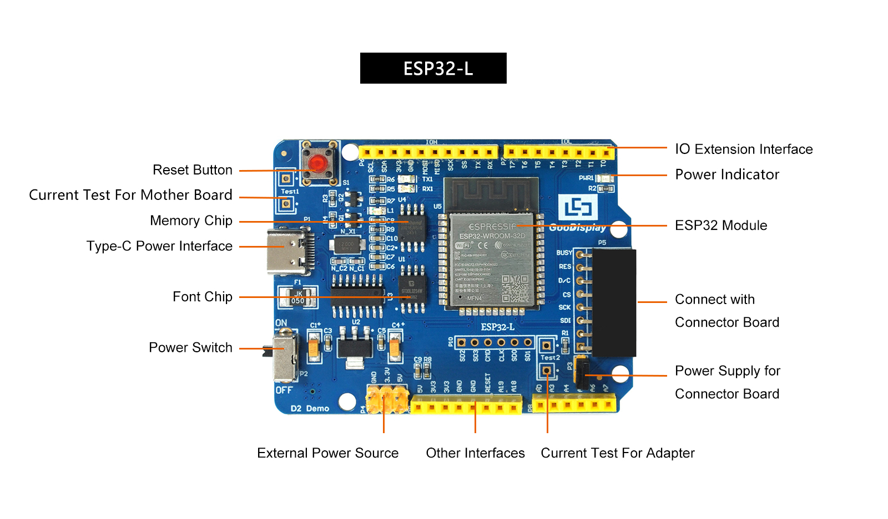
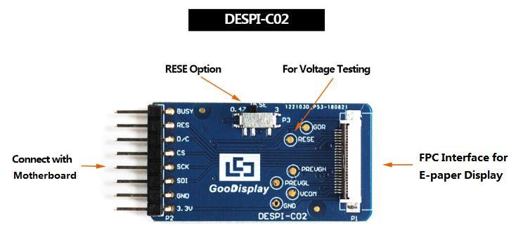

# fast3.7inkdisplay

3.7 寸快刷墨水屏方案：416×240 黑白电子纸 + ESP32，目标是做成一块 **电子工卡 / 桌面日历**，通过 WiFi 更新画面，并接入 AI 模型生成每日内容。

硬件已选型，驱动直接沿用大连佳显（Good Display）的 UC8253 示例，支持全刷 / 快刷 / 局刷 / 4 级灰阶。

> **当前状态**：硬件资料、原理图与厂商驱动示例已归档；WiFi 图传、日历与 AI 接入还在计划中，见 [路线图](#路线图)。

<p align="left">
  
  
</p>

## 特性

| 项目 | 参数 |
| --- | --- |
| 屏幕尺寸 | 3.7 英寸 |
| 分辨率 | 416 × 240（横向），PPI 129.8 |
| 显示颜色 | 黑 / 白，最高 4 级灰阶 |
| 驱动 IC | UC8253 |
| 接口 | 4 线 SPI（3.3 V） |
| 刷新时间 | 全刷 2 s / 快刷 1.5 s / 局刷 0.3 s（25 ℃） |
| 刷新功耗 | 18 mW |
| 待机功耗 | 0.003 mW（断电保持画面，不刷新不耗电） |
| 可视区域 | 81.54 × 47.04 mm |
| 外形尺寸 | 92.99 × 53 × 1.0 mm |
| 工作温度 | 0 ~ 50 ℃ |
| FPC | 24 pin，间距 0.5 mm |

## 硬件组成

| 部件 | 型号 | 说明 |
| --- | --- | --- |
| 墨水屏 | GDEY037T03 | 3.7"，416×240，UC8253，24-pin FPC |
| 驱动板 | ESP32-L | ESP32-WROOM-32D，Type-C 供电，CH340 串口，板载字库 GT30L32S4W、Flash W25Q16 |
| 转接板 | DESPI-C02 | 8 pin 排针转 24 pin FPC，板载升压电路与 RESE 选择 |
| 线材 | Type-C 数据线 | 需支持数据传输，不能只用充电线 |

板子长得怎么样、各部分叫什么，见 [docs/images/esp32-l.jpg](docs/images/esp32-l.jpg) 与 [docs/images/despi-c02.jpg](docs/images/despi-c02.jpg)；转接板的电路框图见 [docs/images/despi-c02-block.jpg](docs/images/despi-c02-block.jpg)。

## 硬件连接

1. **短接 ESP32-L 的 P3 跳线**（转接板供电，也就是屏幕供电），不短接屏幕不会亮。
2. **设置 DESPI-C02 上的 P3 拨码**：UC 系列驱动 IC（本屏为 UC8253）选 **0.47 Ω**。RESE 选错会导致屏幕完全不刷新。
3. **插屏幕 FPC**：显示面朝上、金手指朝上插入转接板的 P1 座，插到底后压下黑色卡扣。
4. **对插转接板**：DESPI-C02 的 8 pin 排针直接插到 ESP32-L 的 P5 座。
5. **上电**：Type-C 供 5 V / 1 A 以上。

> 插拔屏幕 FPC 一定先断电，带电插拔可能损坏屏幕。

## 引脚定义

屏幕接口在 ESP32-L 上是 P5（丝印从上到下依次为 `BUSY / RES / D/C / CS / SCK / SDI / GND / 3.3V`），DESPI-C02 上是 P2，两板丝印顺序一致，直接对插。

| 功能 | P5 / P2 引脚 | ESP32 GPIO | 方向 | 说明 |
| --- | --- | --- | --- | --- |
| 3.3V | 1 | — | 电源 | 屏幕与升压电路供电 |
| GND | 2 | GND | 电源 | 共地 |
| SDI | 3 | GPIO23 | 输出 | SPI MOSI |
| SCK | 4 | GPIO18 | 输出 | SPI 时钟 |
| CS | 5 | GPIO27 | 输出 | 片选，低有效 |
| D/C | 6 | GPIO14 | 输出 | 0 = 命令，1 = 数据 |
| RES | 7 | GPIO12 | 输出 | 复位，低有效 |
| BUSY | 8 | GPIO13 | 输入 | 0 = 忙，1 = 空闲 |

补充说明：

- 屏幕只用 SPI 单向写，**MISO（GPIO19）不接屏幕**。
- 示例代码里引脚写的是板子丝印 `A14`/`A15`/`A16`/`A17`，对应 GPIO13 / GPIO12 / GPIO14 / GPIO27，与上表一致。
- GPIO12 是 ESP32 的 strapping 引脚（MTDI）。用现成的 ESP32-L 没问题；自己画板时要保证复位瞬间它为低电平，否则可能起不来。
- ESP32-L 板载字库芯片的 CS 是 GPIO15、Flash 芯片的 CS 是 GPIO2，它们和屏幕共用 SPI 总线，二次开发时不要把这俩脚拉低。

完整的丝印 / GPIO 对照和电源跳线说明见 [docs/pinout.md](docs/pinout.md)。

## 快速开始

### 1. 环境

- Arduino IDE 2.x
- ESP32 开发板支持包（Boards Manager 搜 `esp32` 安装）
- CH340 驱动（不装识别不到串口）

开发板选 **WEMOS LOLIN32**，下载波特率 **921600**。

### 2. 烧录示例

```text
firmware/GDEY037T03_Arduino/GDEY037T03_Arduino.ino
```

用 Arduino IDE 打开后直接下载即可，代码里已经按 ESP32-L 的引脚配置好了。

### 3. 现象

| 阶段 | 现象 |
| --- | --- |
| 上电 | 先全刷清屏，再依次显示全刷图片、快刷图片、4 灰图片 |
| 局刷演示 | 在屏幕上 5 个位置分别刷新 `00:00` 数字 |
| 结束 | 进入 deep sleep，画面保持 |

示例最后停在 `while(1)`，只跑一轮，改代码即可循环。

详细步骤（含驱动安装、常见报错）见 [docs/quick-start.md](docs/quick-start.md)。

## 刷新模式

| 模式 | 初始化函数 | 耗时 | 说明 |
| --- | --- | --- | --- |
| 全刷 | `EPD_Init()` | 2 s | 会闪几次，用于清残影 |
| 快刷 | `EPD_Init_Fast()` | 1.5 s | 只闪一次 |
| 局刷 | `EPD_Init_Part()` | 0.3 s | 不闪，适合时钟、数字 |
| 4 灰 | `EPD_Init_4G()` | 2 s | 4 级灰阶 |

使用约定（厂商要求，照做能明显延长屏幕寿命）：

- 每次刷完调 `EPD_DeepSleep()`，不要省略。
- 快刷 / 局刷连续做 5 次后，安排一次全刷清残影。
- 每次全刷前重新初始化。
- 做局刷前先写一次基图（`EPD_SetRAMValue_BaseMap`），否则画面会不稳定。

## 仓库结构

```text
fast3.7inkdisplay/
├── README.md                  # 本文件
├── docs/
│   ├── hardware.md            # 硬件细节：供电、跳线、RESE、升压电路
│   ├── pinout.md              # 引脚与丝印对照
│   ├── quick-start.md         # 从装驱动到点亮屏幕
│   ├── references.md          # 官方资料与链接
│   ├── hardware/              # 原理图、规格书、用户手册（PDF）
│   └── images/                # 板卡图片
└── firmware/
    ├── README.md              # 示例说明
    └── GDEY037T03_Arduino/    # 厂商 UC8253 Arduino 示例（全刷/快刷/局刷/4 灰）
```

## 路线图

- [x] 硬件选型与资料归档（屏幕 / 驱动板 / 转接板）
- [ ] 点亮屏幕，验证全刷 / 快刷 / 局刷 / 4 灰
- [ ] WiFi 图传：走厂商 `ImageToWiFi` / `EpdAllWiFi` 固件，或自己实现 HTTP 收图 + 解码
- [ ] 桌面日历：天气 + 日程，定时局刷，到点全刷清残影
- [ ] AI 接入：调用大模型生成"今日安排 / 每日一句"，渲染成 416×240 位图后推送
- [ ] 工卡模式：头像 + 姓名 + 部门 + 二维码
- [ ] 低功耗：RTC 定时唤醒 + 深睡，评估电池方案
- [ ] 外壳 / 结构件

## 常见问题

| 现象 | 排查 |
| --- | --- |
| 屏幕完全不刷新 | RESE 拨码是否在 0.47；ESP32-L 的 P3 跳线是否短接；FPC 方向与卡扣；供电是否 5 V / 1 A 以上 |
| 画面花、有残影 | 快刷 / 局刷次数过多，做一次全刷；局刷前是否写了基图 |
| 电脑识别不到串口 | 装 CH340 驱动；换一根能传数据的 Type-C 线 |
| 下载失败 | 板型选 WEMOS LOLIN32；换 USB 口和数据线；把波特率降到 115200；重新插拔让 CH340 自动进入下载模式 |
| 只显示一半 / 图像错位 | 面板原生扫描方向是 240 × 416：每行 240 像素（30 字节）、共 416 行，横屏图要先旋转再取模 |

## 资料

- 原理图与手册：[docs/hardware/](docs/hardware/)（ESP32-L、DESPI-C02、屏幕驱动说明）
- 官方资料与工具链接：[docs/references.md](docs/references.md)
- 屏幕规格书：见 [Good Display GDEY037T03 页面](https://www.good-display.com/product/437.html)

## 版权说明

`firmware/` 下的示例代码、`docs/hardware/` 下的 PDF 均来自大连佳显电子（Good Display）公开资料，版权归原厂所有，这里仅作学习与二次开发参考。本仓库自行编写的文档与后续代码采用什么许可证待定。

---

**English**: A 3.7-inch 416×240 fast-refresh e-paper (GDEY037T03, UC8253) driven by an ESP32-L board through a DESPI-C02 adapter. Full refresh 2 s, fast refresh 1.5 s, partial refresh 0.3 s, 4-level grayscale. The goal is a WiFi-connected e-badge / desk calendar that pulls weather and schedule, optionally generated by an AI model. Schematics, manuals and the vendor Arduino demo live in `docs/` and `firmware/`.
